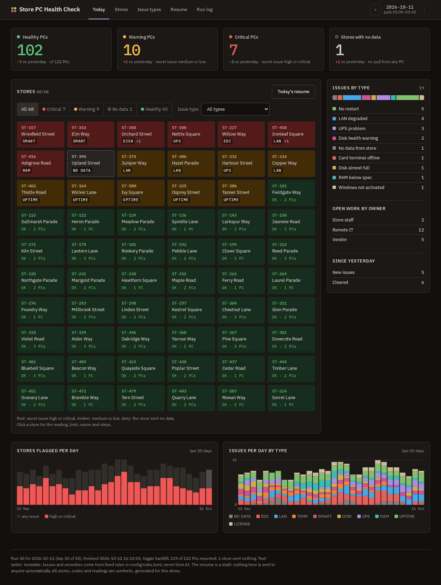
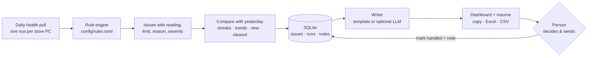
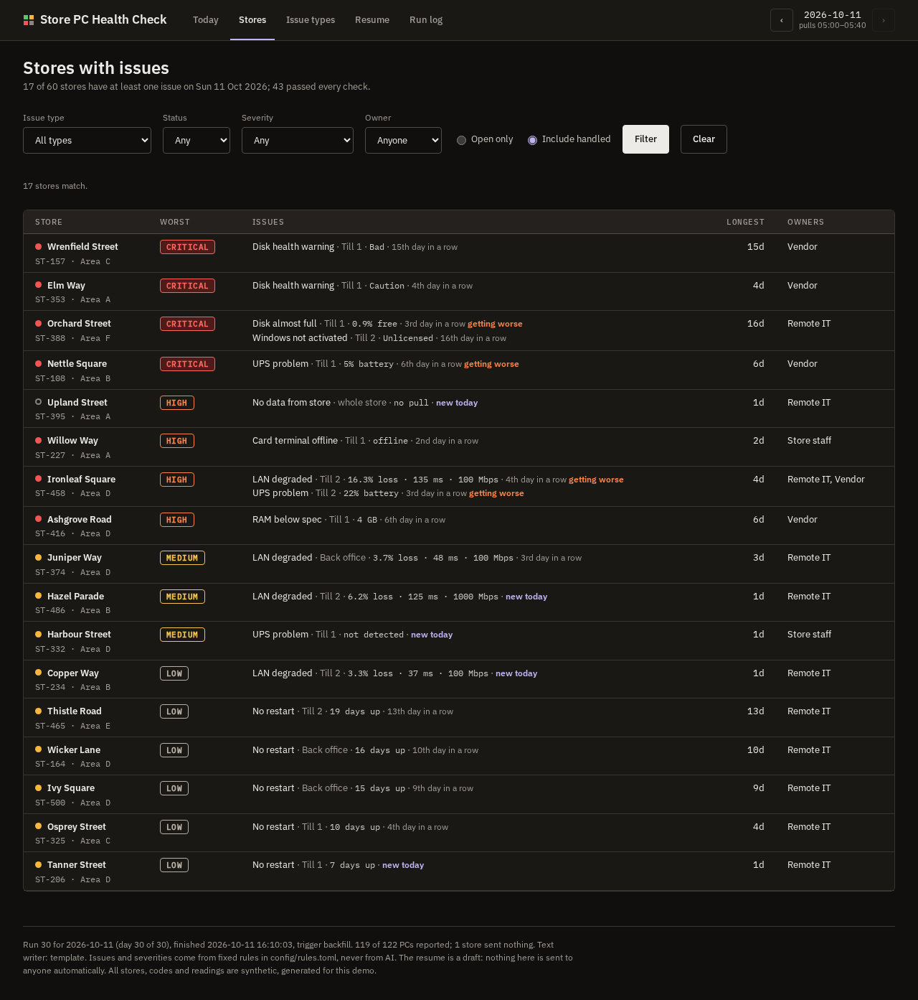
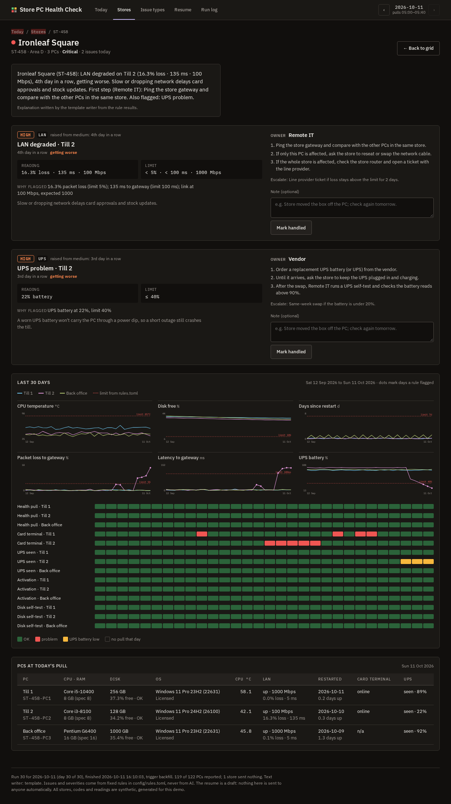
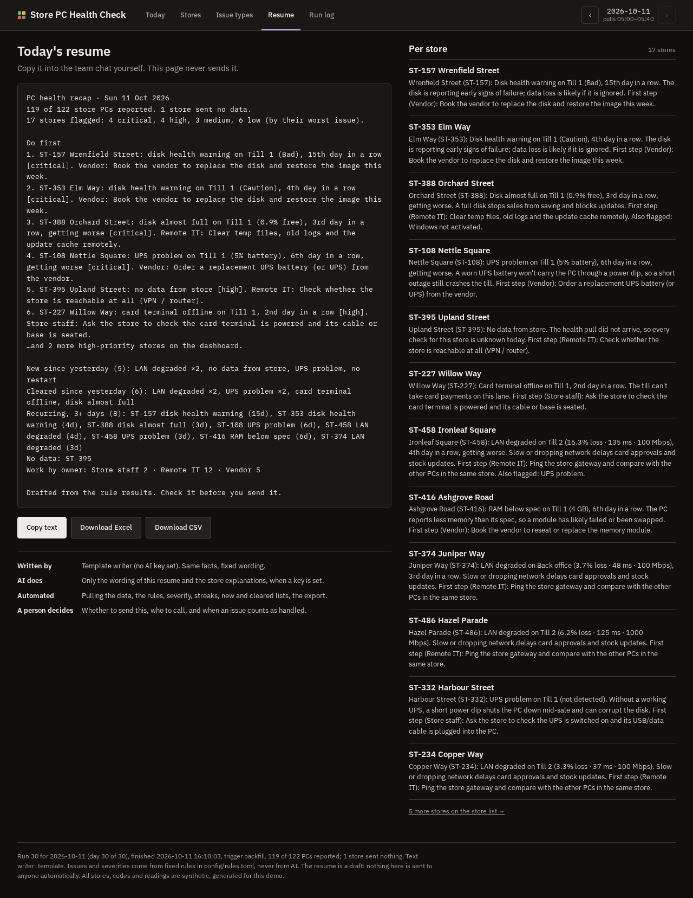
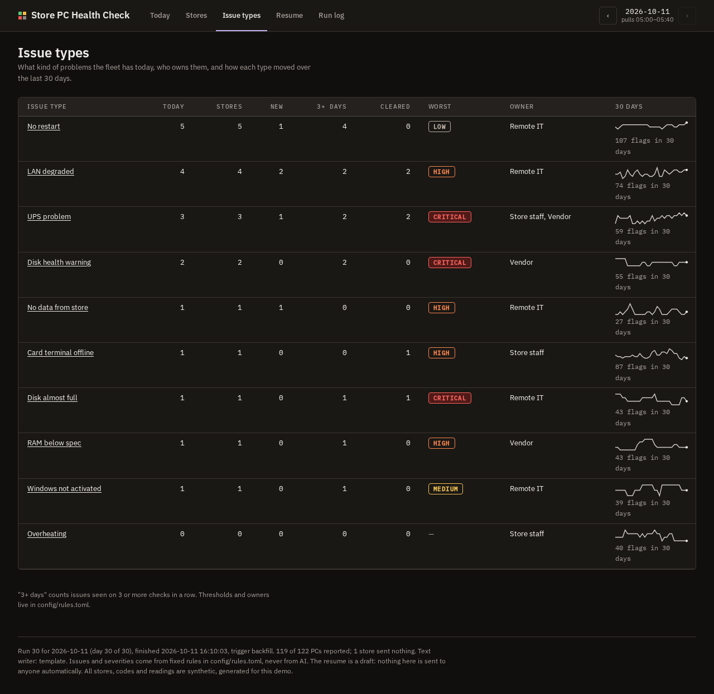
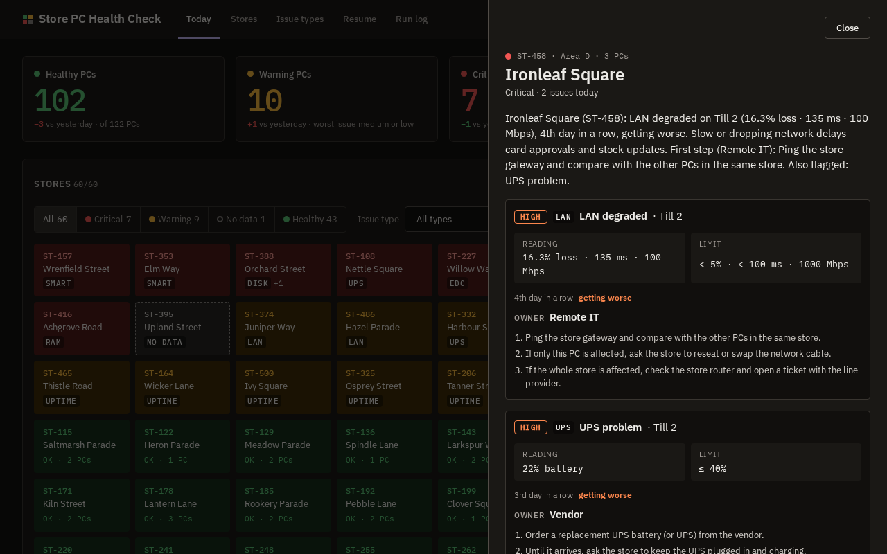

# Store PC Health Check

Every store PC already sends a daily health pull: temperature, specs, disk, network, last restart, Windows activation, card terminal (EDC) status and UPS. Turning that pile of readings into **"which stores need someone today, what is wrong, and who fixes it"** is still often done by hand in a spreadsheet every morning.

This project automates that roll-up. A deterministic rule engine checks every PC against thresholds in one config file. It tracks how long each problem has lasted and whether it is getting worse, lists what is new and what cleared since yesterday, and attaches a handling playbook with an owner to each issue. The output is a daily dashboard and a copy-ready resume. An optional LLM rewrites the resume in plain English, but it never decides what counts as an issue or how severe it is.

All stores, codes and readings are **synthetic**. Nothing here comes from a real company.



The Today screen is a status board: PC counts (healthy, warning, critical) and stores with no data, each with the change since yesterday; one tile per store coloured red, amber, green or grey and filterable by status and issue type; the issue mix; and 30-day trends. Click a store to open a side panel with the reading vs limit, owner, steps and 30-day per-PC charts.

## What it does every morning

1. **Collect.** It takes the day's pull for each store PC. In this demo a simulator generates the pulls: 60 invented stores, 1–3 PCs each, about 120 PCs in total.
2. **Check.** Fixed rules from [`config/rules.toml`](config/rules.toml) run on every reading. Each finding records the reading, the limit and the reason, for example `16.3% packet loss (limit 5%); 135 ms to gateway (limit 100 ms)`.
3. **Compare with yesterday.** It counts how many days in a row each issue has been seen ("4th day in a row") and checks the trend over the last 3 readings ("getting worse"). It lists issues that are new today and issues that cleared since yesterday. A store that sent no data is never counted as fixed.
4. **Rank and assign.** Severity runs low, medium, high, critical. An issue seen on 3 checks in a row moves up one level. Stores are ranked by their worst issue, and each issue gets a playbook with an owner (store staff, remote IT or vendor), the steps to take and when to escalate.
5. **Write.** It drafts the daily resume and a short explanation per store. The writer is a template by default, or an LLM if you set an API key.
6. **Show, don't send.** The dashboard has a copy button and Excel/CSV export. Nothing is sent to anyone automatically.



## Checks

| Issue | Rule (defaults, all in `config/rules.toml`) | Owner |
|---|---|---|
| No data from store | no pull from any PC in the store | Remote IT |
| Card terminal offline | EDC did not answer at the pull → high | Store staff |
| LAN degraded | link down → critical; loss ≥ 5% or latency ≥ 100 ms → medium; link below 1000 Mbps → low | Remote IT |
| Overheating | CPU ≥ 85 °C → high; ≥ 95 °C → critical | Store staff |
| Disk health warning | SMART `Caution` → high; `Bad` → critical | Vendor |
| Disk almost full | ≤ 10% free → medium; ≤ 3% → high | Remote IT |
| UPS problem | not detected → medium; battery ≤ 40% → medium, ≤ 20% → high | Store staff / Vendor |
| RAM below spec | installed RAM < the PC's spec (min 8 GB) → medium | Vendor |
| No restart | up ≥ 7 days → low; ≥ 21 days → medium | Remote IT |
| Windows not activated | not `Licensed` → low; `Unlicensed` → medium | Remote IT |

An issue seen on 3 checks in a row moves up one severity level. Restarts and activation are exempt because they are slow-moving by nature.

## Who does what

| AI does | Automated (no AI) | A person decides |
|---|---|---|
| Rewords the daily resume and the per-store explanations, **only if an API key is set** | Generating/loading the pulls, every rule and threshold, severity, streaks, trends, new/cleared lists, ranking, playbooks, run log, exports, the scheduled run | Whether and where to send the resume, who to call, when something counts as handled (with a note), changing thresholds |
| Its output is rejected (template kept) if it uses any number that is not in the facts, or skips a flagged store | Rerunning a day replaces that day's result (idempotent) and the run log shows it | Anything involving a vendor visit or a cost |

The AI never sees anything except the rule results for that day, and it can't add, drop or re-rank an issue. Without a key, which is the default, the template writer produces the same facts in fixed wording.

## Screens

| | |
|---|---|
|  Store list, filterable by status, issue type, severity and owner |  Store detail: each issue with reading vs limit, playbook, "mark handled"; every PC's specs; 30-day charts with the limit line |
|  Daily resume with copy button, Excel and CSV download |  Issue-type breakdown with a 30-day sparkline each |
|  Side panel after clicking a store tile | |

## Results (measured on the simulator, not on a real fleet)

The simulator records every fault it injects (ground truth). It also injects things that **look** like faults but aren't: a CPU busy at pull time, a backup saturating the link, a card terminal rebooting during the pull, a UPS USB hiccup. Some real faults start slowly, below the limit, such as a fan that gets worse over days, a disk filling up or a UPS battery wearing down. The rules are then scored against that ground truth.

**Important: the rules are tested against their own simulator.** These numbers show the rules do what they are meant to do, and they show where the noise and the slow faults trip them up. They say nothing about accuracy on real store PCs. The noise rates are my own assumptions.

Default dataset (seed 35, 30 days, 12 Sep to 11 Oct 2026, 60 stores, 122 PCs, 3,605 PC-day pulls). One unit is one issue type on one PC on one day:

| Issue type | Found & real | False alarms | Missed | Precision | Recall |
|---|---:|---:|---:|---:|---:|
| No data from store | 27 | 0 | 0 | 100.0% | 100.0% |
| Card terminal offline | 70 | 17 | 0 | 80.5% | 100.0% |
| LAN degraded | 46 | 28 | 2 | 62.2% | 95.8% |
| Overheating | 39 | 1 | 13 | 97.5% | 75.0% |
| Disk health warning | 55 | 0 | 0 | 100.0% | 100.0% |
| Disk almost full | 43 | 0 | 9 | 100.0% | 82.7% |
| UPS problem | 43 | 16 | 8 | 72.9% | 84.3% |
| RAM below spec | 43 | 0 | 0 | 100.0% | 100.0% |
| No restart | 107 | 0 | 0 | 100.0% | 100.0% |
| Windows not activated | 39 | 0 | 6 | 100.0% | 86.7% |
| **All types** | **512** | **62** | **38** | **89.2%** | **93.1%** |

Across **40 independent simulated fleets** (seeds 1–40), overall precision averages **88.7%** (range 85–93%) and recall **90.1%** (range 83–94%). Per-type numbers for those 40 fleets are in [`docs/results/evaluation.md`](docs/results/evaluation.md).

What the numbers mean:

- **False alarms come from one-day noise.** The card terminal, LAN and UPS rules fire on a single bad reading because a till that can't take cards matters today. In the simulator that costs 17–28 false alarms per type over 30 days.
- **Waiting a day removes most false alarms, but you find out later.** When only issues seen on 2 checks in a row are counted, precision on the default dataset goes to 97.8–100% for every type. Recall drops, for example to 64.3% for card terminals and 58.3% for LAN, because each fault is reported a day later. The rules keep the faster version and let the streak raise the severity instead.
- **Misses are slow onsets.** A fan that is warming up (79–86 °C) or a disk filling from 85% used is a real fault but still under the limit, so it's caught a day or two later.
- **Some types are 100% by construction.** RAM, activation, SMART and restarts are clean yes/no readings in the simulator, so those scores only prove the code is wired correctly. Their only misses (6, all activation) were on days the store sent no data.
- **No time-saving claim.** I have not measured how long the manual roll-up takes, so this README doesn't claim any time saved.

Reproduce: `python -m pchealth backfill --end 2026-10-11 && python -m pchealth evaluate --seeds 40`.

Tests: `pytest -q` runs 65 tests covering rule thresholds, streaks, escalation, new/cleared, missing pulls, idempotent reruns, the generator, the LLM guardrails (with a fake provider), the pages, "mark handled" and the exports.

## Run it

```bash
python -m venv .venv && source .venv/bin/activate
pip install -r requirements.txt

python -m pchealth backfill            # 30 days of synthetic pulls ending today + the daily runs
python -m pchealth serve               # http://127.0.0.1:8000

python -m pchealth today               # next day: add only the missing pull(s) and run the check
python -m pchealth run --date 2026-10-11   # rerun one day (replaces that day's result)
python -m pchealth resume              # print today's resume
python -m pchealth export --format xlsx --out recap.xlsx
python -m pchealth evaluate --seeds 40 --out docs/results
```

Optional AI writer: copy `.env.example` to `.env` and set `OPENAI_API_KEY` or `GEMINI_API_KEY`. `.env` is git-ignored.

### Scheduled daily run

- **Local:** [`scripts/daily.sh`](scripts/daily.sh) adds today's pull, runs the check and writes the recap (Excel, CSV and resume text) into `out/`. Put it in cron, for example `0 6 * * *`.
- **GitHub Actions:** [`.github/workflows/daily-check.yml`](.github/workflows/daily-check.yml) runs at 06:00 UTC+7 and uploads the recap as a build artifact. A fresh runner has no database, so in demo mode it regenerates the same deterministic synthetic history first. In real use you would load the real pull and keep the database. It doesn't send anything.

### Using real data

Replace the simulator with a loader that writes one row per PC per day into the `snapshots` table. The columns are listed in [`pchealth/data.py`](pchealth/data.py). The rules, dashboard and exports don't change. Thresholds and playbooks are in `config/rules.toml`.

## Limitations

- **Synthetic data only.** All readings are generated, and so is the noise. I designed the faults and the noise, so the results above are a sanity check, not evidence of real-world accuracy.
- **Single readings.** One pull per PC per day: a problem that comes and goes between pulls is invisible, and a single bad reading at pull time can be a false alarm (see the table).
- **Fixed thresholds.** The limits are the same for every PC. It has no per-model temperature limits and no learned baselines.
- **Playbooks are generic.** They're starting points per issue type (plus one variant for low UPS battery), not a full troubleshooting guide.
- **"Handled" is a note, not a ticket.** It doesn't connect to a ticketing system. If the problem is still there tomorrow, it's flagged again.
- **LLM output not measured.** No API key was available while building this, so every result and screenshot uses the template writer. The LLM path is covered by tests with a fake provider only.
- **Single user.** It has no login, no roles and SQLite only. It's fine on a laptop or a small server, not as a shared multi-team service.

## Project layout

```
config/rules.toml        thresholds, severities, playbooks (owner, steps, escalation)
pchealth/generator.py    synthetic fleet + daily pulls + injected faults (ground truth)
pchealth/rules.py        deterministic checks and trend logic
pchealth/engine.py       daily run: streaks, escalation, new/cleared, run log (idempotent)
pchealth/resume.py       template writer + LLM guardrails
pchealth/llm.py          optional OpenAI / Gemini client (structured JSON)
pchealth/evaluate.py     precision / recall vs injected faults, multi-seed
pchealth/web.py          FastAPI + Jinja2 dashboard, inline SVG charts (charts.py)
pchealth/export.py       CSV / Excel recap
```

Design: server-rendered HTML, no JS framework. The visual system follows the [Hallmark](https://github.com/nutlope/hallmark) rules: Newsprint theme, stat-led overview, masthead nav and a run-log colophon.

MIT License.
